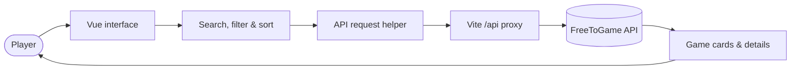

<div align="center">


# Free Games Finder

### Find your next free-to-play game without the scrolling

Browse a large catalog of free-to-play games, search by title, narrow the results with filters, and open a game for its full details — all from a fast, responsive Vue application.

<p>
  <a href="#getting-started">Get started</a>
  &nbsp;&bull;&nbsp;
  <a href="#features">Explore features</a>
  &nbsp;&bull;&nbsp;
  <a href="#project-structure">View the code</a>
</p>


</div>

---

## What is it?

**Free Games Finder** is a focused game-discovery interface powered by the [FreeToGame API](https://www.freetogame.com/api-doc). It turns a large list of free-to-play titles into an easy-to-scan card grid, with useful controls for finding something to play quickly.

The app is built as a single-page experience: the home view loads the catalog, URL query parameters preserve search and filter state, and selecting a card opens an expanded detail view without leaving the page.

## Features

| | Capability | What it does |
|---|---|---|
| 🔎 | **Title search** | Search the loaded catalog for games by title. |
| 🎛️ | **Flexible filters** | Filter by platform and genre, then apply a sort order. |
| 🗂️ | **Sorting** | Sort alphabetically or by release date through the API. |
| 🃏 | **Game cards** | Scan thumbnails, descriptions, publishers, genres, and platforms at a glance. |
| 📖 | **Expanded details** | Open a game to see its full description, screenshots, system requirements, and links. |
| 🌙 | **Light and dark mode** | Follows the operating system color-scheme preference. |
| 📱 | **Responsive layout** | Adapts the card grid and navigation for smaller screens. |
| ⚠️ | **Clear API errors** | Surfaces connection and request failures with user-friendly messages. |

## How it works



In development, Vite proxies `/api` requests to `https://www.freetogame.com`. The frontend uses `/api` by default, while `VITE_API_BASE_URL` can be used to point the app at another API base URL.

## Tech stack

- **Vue 3** with `<script setup>` and the Composition API
- **TypeScript** for typed game data and component contracts
- **Vue Router** for the single-page route and query-driven UI state
- **Vite** for development, proxying, and production builds
- **ESLint, Oxlint, Prettier, and vue-tsc** for code quality and type checking

## Getting started

### Prerequisites

- [Node.js](https://nodejs.org/) `22.18+` or `24.12+`
- npm

### Install and run

```sh
git clone https://github.com/JenniferVonT/free-games-finder.git
cd free-games-finder
npm install
npm run dev
```

Open the local URL printed by Vite, usually `http://localhost:5173`.

### Optional API configuration

The app defaults to `/api`, which is proxied to FreeToGame during local development. To use a different backend, create a `.env.local` file:

```env
VITE_API_BASE_URL=https://your-api.example.com/api
```

The API is expected to expose:

```text
GET /games
GET /games?category=<genre>&platform=<platform>&sort-by=release-date
GET /game?id=<game-id>
```

## Available commands

| Command | Purpose |
|---|---|
| `npm run dev` | Start the Vite development server with hot reload. |
| `npm run build` | Type-check and create an optimized production build. |
| `npm run preview` | Preview the production build locally. |
| `npm run type-check` | Run `vue-tsc` without producing a bundle. |
| `npm run lint` | Run the Oxlint and ESLint checks. |
| `npm run format` | Format source files with Prettier. |

## Project structure

```text
src/
├── App.vue                 # Application shell and shared layout
├── main.ts                 # Vue app entry point
├── assets/                 # Theme styles and logo
├── components/             # Navigation, cards, filters, search, and icons
├── router/                 # Vue Router configuration
├── utils/
│   ├── api.ts              # API base URL, requests, and error handling
│   ├── games.ts             # Game queries, filtering, sorting, and types
│   └── genreTypes.ts        # Supported genre values
└── views/
    └── HomeView.vue         # Catalog, search results, filters, and details
```

## Data and attribution

Game data is provided by [FreeToGame](https://www.freetogame.com/). This project is an independent frontend client and is not affiliated with or endorsed by FreeToGame.

## Contributing

1. Create a feature branch.
2. Make focused changes that match the existing Vue and TypeScript patterns.
3. Run `npm run lint`, `npm run type-check`, and `npm run build`.
4. Open a pull request with a short description of the user-facing change.

## License

This project is available under the [MIT License](./LICENSE).
